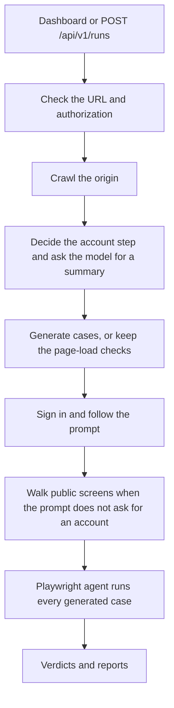

# Architecture and flow

This is the Phase 0 QA orchestrator: a local FastAPI app that opens one authorized website in Chromium, decides what to do from the prompt, and writes a verdict for each check. One run uses one browser. A second run waits until the first finishes.

The model can choose a next step and write a short summary. It does not assign the verdict, and it cannot add an action outside the allowed set.

## Pieces

| Area | Path | What it does |
| --- | --- | --- |
| HTTP and dashboard | `app/main.py`, `app/templates/`, `app/static/` | Accepts a run, serves the live page, and reads artefacts back. |
| Pipeline | `app/orchestrator.py` | Runs the phases in order and holds the single-run lock. |
| Crawl | `app/discovery/` | Opens pages on the authorized origin and records titles, headings, and errors. |
| Cases | `app/generation/` | Turns those pages, and the prompt in hybrid mode, into test cases. |
| Account and prompt | `app/mind/` | Remembers one account, signs in, and follows the prompt one screen at a time. |
| Playwright agent | `app/execution/agent.py` | Runs every generated case in Chromium. |
| Step runner | `app/execution/runner.py` | Performs the six allowed actions and keeps video only for a failed or inconclusive case. |
| Verdict | `app/execution/verdict.py` | Decides PASS, FAIL, INCONCLUSIVE, or BLOCKED from the steps. |
| Safety | `app/security/` | Same-origin URLs, redaction, and paths that stay inside the run directory. |
| Reports | `app/reporting/writer.py` | Writes the markdown and JSON for the run. |
| Demo site | `app/demo.py` | A small site on `/demo/` with a runtime error and a missing page. |

Settings come from the environment and a gitignored `.env`. `QA_HF_TOKEN` and `QA_LLM_API_KEY` are read there and are never written into a report, an event, or a prompt that leaves the process. `app/config.py` lists the timeouts.

## One run

1. **Intake.** The form or `POST /api/v1/runs` must confirm authorization. The target is reduced to one origin. Query strings longer than 200 characters are rejected. The run directory is `runs/<run_id>/`.
2. **Explore.** Chromium opens the start URL and follows same-origin links up to `max_pages` and `max_depth`. A redirect off the origin is recorded and its body is discarded. A challenge page becomes a blocked manual case instead of a passing smoke check.
3. **Mind.** `decide` looks for a signup or sign-in page and for a remembered account. `advise` asks Hugging Face for a short summary and a focus, when `QA_HF_TOKEN` is set. The account rule stays in code: a prompt that does not ask for an account does not create one, and a prompt that asks for a new user creates one even if an older account is remembered.
4. **Design.** Hybrid mode parses the prompt into requirements. The model then reads each crawled screen (title, headings, buttons, form fields, and excerpt) and writes one case for that screen before any signed-in walk. A step is kept only when its URL, title, heading, or text was actually seen. A screen the model does not finish keeps its page-load check. A page that already showed a console error also keeps a runtime case. Unknown actions, off-origin URLs, and destructive paths are dropped. If every model reply is unusable, the page-load cases remain and the design event says so.
5. **Journey.** When the decision includes an account, the journey signs up once or signs in with the remembered account. A prompt is then followed one grounded step at a time. An empty prompt walks the navigation instead.
6. **Look around.** This runs only when the prompt does not ask for an account. It clicks safe public controls and does not submit quotes, payments, or messages.
7. **Playwright agent.** `run_generated_cases` executes every generated case, including a page the journey already opened. Each case gets its own browser context. The gate refuses a case with no steps, an action outside the six, a goto off the origin, or a goto that was not discovered.
8. **Report.** `judge` reads the steps. The run page and the files under the run directory show the same verdicts.

The live page polls `/api/v1/runs/{id}/activity` and `/live/frame.png`. The frame is one PNG overwritten as the browser moves. Notes in “What I'm doing” are the `mind` events.

## Following a prompt

`app/mind/follow.py` asks the model for one JSON step: `click`, `fill`, `sign_in`, or `done`. The step is kept only when the screen supports it.

- A click must match a button on the screen, and it must not be pay, purchase, checkout, delete, logout, sign out, upgrade, ticket, WhatsApp, send, or remove.
- A fill runs only while a form is open. The password is stored for the next sign-in and is not written into the note.
- A sign-in is allowed only for a role named in the prompt. It opens a fresh context, chooses that role (a radio or a button), and uses the remembered owner for an admin role and the login just created for any other role.
- `done` is accepted when the unfinished part of the prompt is complete.

The unfinished part is computed from the prompt and from what has already happened: create, then copy the credential the page shows, then sign in as the next role, then open the screens that role shows. A page alert replaces that part until it is handled. Copying the account that is already signed in does not count as the new login.

An end-to-end prompt signs in with the remembered account and walks the screens of that role. It also keeps a generated case for every crawled page.

The number of steps and the wall-clock budget grow with the prompt. A request that creates an account, copies a login, signs in as another role, and checks a flow gets more time than a request that only opens the home page. The floor is `QA_RUN_TIMEOUT_S` (420 seconds). The cap is 900 seconds.

A generated case that fails is run once more, and the suite continues either way. An assertion failure does not skip the later steps of that case. A browser error still stops that attempt.

## Generated cases

The Playwright agent is the only place that executes the generated suite. The six actions are:

- `goto`
- `assert_http_status`
- `assert_title`
- `assert_heading`
- `assert_text`
- `assert_no_page_errors`

There is no `evaluate`, no shell, and no script supplied by the model.

## Verdicts

| Verdict | When |
| --- | --- |
| PASS | Every step passed. |
| FAIL | An assertion failed on a page that loaded. Classification is `product_bug`. |
| INCONCLUSIVE | A timeout or other browser error. Classification is `environment`. |
| BLOCKED | The case was refused before it ran, or the requirement asks for a destructive or payment action. |

Classification is stored beside the verdict and does not change it. Video, screenshot, and trace are kept for FAIL and INCONCLUSIVE.

## Memory

Each origin has `runs/memory/<sha256 prefix>.json` and a Playwright `storage_state` file next to it. The JSON holds the username, password, and logins created during a run. `scrub` removes those secrets from notes and reasons before they are stored on the run.

## What stays closed

The crawl and the runners stay on the authorized origin. Paths that contain logout, delete, checkout, payment, purchase, transfer, or admin are treated as destructive. The prompt follower will not click pay, delete, logout, or send. A Gmail signup may continue on `accounts.google.com` and `mail.google.com` until the page asks for a phone or a captcha, and it does not send mail.

Phase 0 does not publish to Jira or GitHub, and it does not run Android, iOS, or TV.
