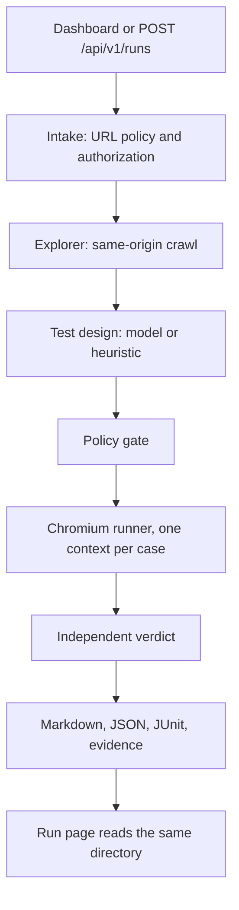

# Implementation plan — Phase 0

Date: 22 November 2026.

There was no existing pilot. This repository is the Phase 0 vertical slice: a single Python process, a filesystem run store, and Playwright Chromium. Later phases in the master spec (mobile, TV, Postgres, Redis, Jira, GitHub publishing) are not started. `GET /api/v1/capabilities` lists them as `NOT_IMPLEMENTED`.

## Layout

```
app/main.py                 HTTP entrypoint, dashboard, artefact routes
app/demo.py                 Fixture site
app/orchestrator.py         Intake, crawl, design, execute, report
app/config.py               Environment settings, API key never copied out
app/models.py               Schema 1.0.0 contracts
app/security/               URL scope, path ids, redaction
app/discovery/crawler.py    Bounded same-origin Playwright crawl
app/generation/             Heuristic cases, optional model call, validator
app/execution/              Policy gate, Chromium runner, independent verdict
app/reporting/writer.py     Markdown, JSON, JUnit, defect drafts, cost ledger
app/storage/runs.py         One directory per run
app/templates, app/static   Server-rendered dashboard
tests/unit                  Policy, verdict, generation, encoding
tests/integration           Live server and Chromium
```

The dashboard is server-rendered HTML, not a React app. Phase 0 needs one process that can be started with uvicorn. A separate frontend build is a later control-plane choice, not part of this slice.

## Flow



1. The request must set `authorization_confirmed` and pass URL checks. Credentials in the URL are rejected. Link-local and metadata addresses are rejected. Any later URL must match the authorized scheme, host, and port.
2. Chromium opens pages up to `max_pages` and `max_depth`. It records title, headings, a redacted text excerpt, link labels, button labels, form field names and types, HTTP status, console errors, and page errors. It does not read input values. Off-origin redirects are recorded as escapes and their body text is dropped. Destructive paths are not fetched.
3. With no `QA_LLM_API_KEY`, or when model JSON is invalid, unsafe, or ungrounded, design writes deterministic smoke cases and puts the fallback reason in `open-questions.md`. A grounded model suite is kept and marked `provenance: llm`. Unsafe output (off-origin URL, disallowed action, path-like id) discards the whole model suite.
4. Every case is gated again. Allowed actions are `goto`, `assert_http_status`, `assert_title`, `assert_heading`, `assert_text`, and `assert_no_page_errors`. There is no evaluate and no shell.
5. The verdict function sees step results and runner errors only. Assertion failure on a loaded page is `FAIL`. A timeout or browser error is `INCONCLUSIVE` with classification `environment`. A denied or empty case is `BLOCKED`. Classification is stored beside the verdict and does not replace it.
6. FAIL and INCONCLUSIVE keep a webm, PNG, and trace zip. PASS deletes its video and trace. Reports are written under the run directory before the status becomes `completed`, so a refresh still finds them.

## Demo fixtures

| Route | What it is | Expected verdict |
| --- | --- | --- |
| `/demo/` | Home | PASS smoke |
| `/demo/help` | Help Centre, including a password field whose value must not be stored | PASS smoke |
| `/demo/pricing` | HTTP 200 with a catalog failure marker and a console error | PASS smoke, FAIL `runtime_error` |
| `/demo/missing` | Linked 404 | FAIL `reachability` |
| `/demo/fixtures/slow` | Responds after the navigation timeout | INCONCLUSIVE `environment` |
| Hybrid purchase or delete requirement | Not executed | BLOCKED |

## Cost

The ledger records token counts, tool calls, wall-clock time, and measured file bytes. It does not invent a currency amount. No price table is shipped.

## Out of this phase

Authenticated storage state, OpenAPI checks, axe, visual diffs, retries, case versioning beyond the schema field, Postgres, Redis, and issue publishing. A destructive requirement stays a blocked draft.
